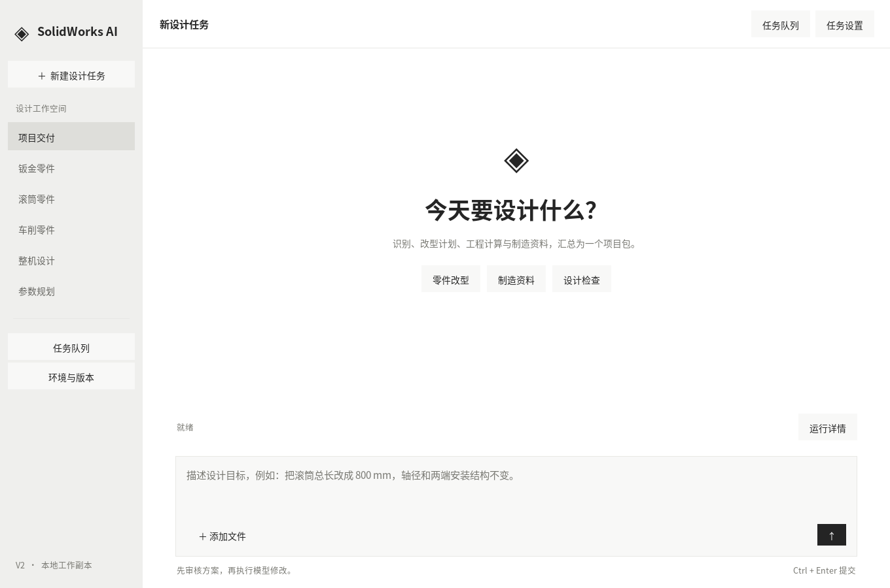
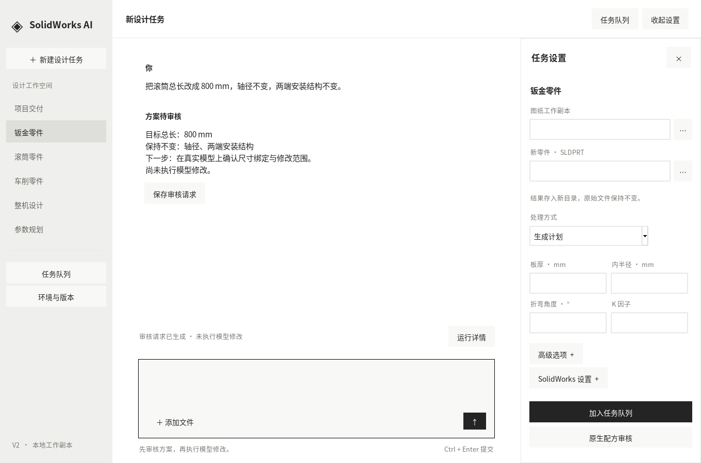

# 对话式设计工作台

在统一集成候选 a8c3c719d6840db40bf08575972d532017fa3945 上增量改界面，保留原后端CLI/串行队列/审核/源码绑定。原生测试分支没有改变。

```bash
python app.py
```

界面采用接近Codex的结构：灰色左侧工作空间、中央对话、底部指令输入，以及可收起的右侧任务设置。默认隐藏详细日志和长参数表；任务类型使用中文。任务队列是独立窗口，保留运行/当前任务后停止/结果状态；详情仍可查看完整记录。





## 如何使用

- 在底部输入滚筒总长及保护接口指令，Ctrl+Enter生成审核请求，可保存JSON。复用既有受限解析器，不是开放式AI聊天；未支持的指令明确提示。生成请求不等于加入执行队列，更不会直接改模型。
- 点击“任务设置”，选当前任务的配置/图纸与新输出位置，再加入队列。钣金仅在规划/生成时要求本单t/R/角度/K；仅识别图纸不要求折弯参数。
- 高级选项保留轮廓/规格索引和显式默认尺寸许可；原生生成自动展开SolidWorks设置，但仍须核对并确认。输入/方向变化立即取消确认。
- 整机与统一项目继续使用已有JSON契约，参数规划继续使用已有机型和目标包络；不替换QL/OEM数据。
- 运行中锁定任务输入；停止等待当前任务，不强制关闭CAD。原生配方审核继续调用现有对话框；其回传不会清掉尚未运行的普通队列。
- 审核请求只保存到新文件，拒绝覆盖；运行产物仍由原后端检查独立目录和原件保护。

入口 app.py 保持导入无窗口；显示逻辑在 src/desktop_ui.py；GUI输入转换在 src/desktop_jobs.py，最终仍调用project_workbench.build_command/confirm_job/run_batch。

## 验证范围

- 6项UI输入/既有后端合约检查通过：隐藏字段不误拦截、每单钣金参数、原生审核拒绝及源文件变化拒绝等。
- 在Linux虚拟显示、系统Tk8.6与CJK字体下实际创建窗口，5项交互检查通过：抽屉/字段切换、指令仅生成审核、输入变化取消确认、导出防覆盖、原生回传保留待执行队列。另检查1360×900与1080×740布局；上述PNG为真实窗口截图，不是设计示意图。
- 集成回归792项运行：783通过、9跳过、0失败/错误。9跳过为原4项本机夹具/转换器缺失，加无显示回归环境下5项GUI检查；5项GUI已在虚拟显示中另外实际通过。没有Windows/SolidWorks实测。

Windows仍需检查字体/DPI/缩放、文件选择对话框、原生配方审核、队列运行与停止。完整原生验收沿用统一候选矩阵，不因界面预览或离线检查升级结果。
