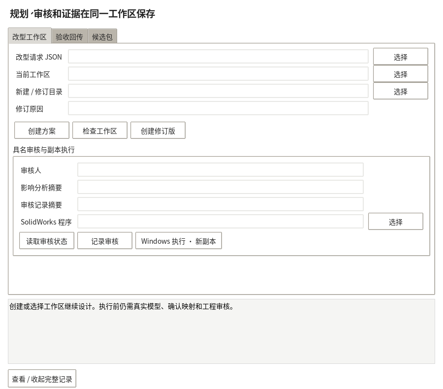
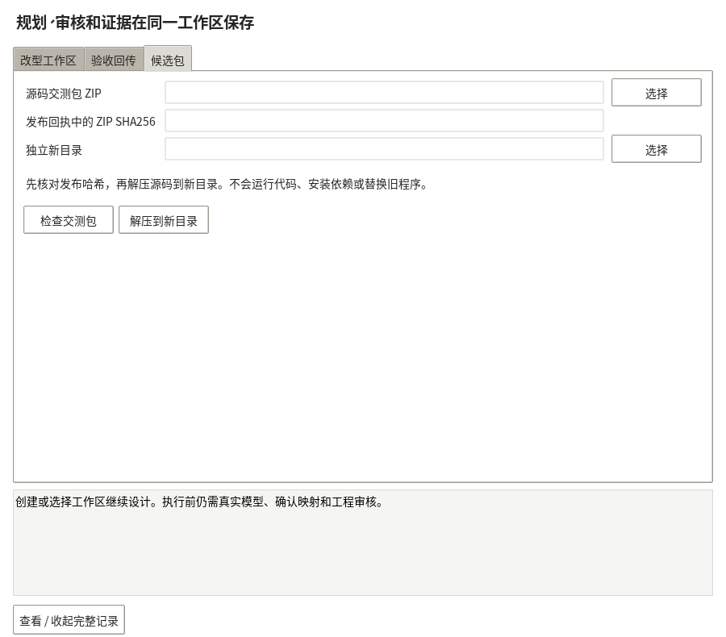

# 交付完善：候选包导入、工作区修订、验收比较

本批基于 PR #63 的完整候选做增量，继续复用其规划、审批、原生副本事务、源码打包和证据审核。
不改原生几何/COM 执行器，不移动 #63 的验收 pin，不覆盖用户程序。

## 候选包导入

新增 release_install.inspect_kit / install_kit，桌面“项目交付 / 验收 → 候选包”可直接使用。

```powershell
python work/delivery.py inspect-kit <gork-test-kit.zip> --kit-sha256 <发布回执的ZIP-SHA256>
python work/delivery.py install <gork-test-kit.zip> --kit-sha256 <发布回执的ZIP-SHA256> --out <独立新目录>
```

安装在创建目录前检查外部发布哈希、候选身份、源码归档/manifest、源码版本、矩阵、逐文件 SHA256
及可选 Git blob 索引。拒绝路径越界、符号链接、Windows 保留名、大小超限、大小写碰撞和未列入清单的文件。
没有外部校验值时只可预览，不可导入。它不自动运行源码、不安装 Python/依赖、不启动 SolidWorks。
成功后生成 app/、candidate/ 和 installation.json；candidate/ 保留源 ZIP，可用原 verify-candidate 再验。
原程序目录必须保留，已存在输出目录一律拒绝；中途写入失败保留不完整标记供检查。

已使用 PR #63 发布的完整 511 文件源码交测包验证导入、候选校验和解压源码校验，均通过。
这不是 Windows 安装包或 SolidWorks 实机验证。

## 工作区诊断与修订

```powershell
python work/delivery.py inspect-workspace <旧工作区>
python work/delivery.py revise <旧工作区> --request <完整修订请求.json> --reason "目标或实现变化原因" --out <新的独立工作区>
```

旧方案因原模型、代码、规划或审批变化而不能执行时，inspect-workspace 仍能给出结构化原因、
修改项/保护接口摘要和下一步；读取不会授予写权限或改动旧记录。
修订重新调用已有规划/影响分析链，保存父工作区、父记录哈希、修订原因和 JSON 字段差异。
修订文件的哈希绑定到新工作区；篡改或缺失会使审核失效。
原审核不会复制，必须对新方案重新具名审核。

已有 execution-claim 的工作区仍保留现场并拒绝修订绕过。没有提供进程退出证明的自动恢复/重试没有开放，
也不提供清标记强行续跑。代码变化但请求相同可以重新规划；请求和实现都相同则不生成无意义版本。

## 验收比较与回执

```powershell
python work/delivery.py audit <matrix.json> <submission.json> --evidence-root <证据目录> --previous-report <上轮audit.json> --out <新报告目录>
python work/delivery.py compare-audits <上轮audit.json> <本轮audit.json> --out <新的comparison.json>
```

repair-tasks 的标识包含源码 SHA，避免把不同版本的问题错误合并。
比较结果区分回归、证据改善、新版本/新增检查、未再报告、问题内容变化。
不同源码版本之间不自动销项；补证通过只记录“仍需工程复核”，不自动关闭机械缺陷或生产放行。
报告目录新增 comparison.json（提供上轮报告时）和带文件/报告哈希的 receipt.json；已有报告不能覆盖。

## 界面

窗口分成“改型工作区 / 验收回传 / 候选包”三页，默认显示简短状态与下一步，完整 JSON 可切换查看。
压缩表单间距，保证审核和 Windows 副本执行按钮在正常窗口尺寸内可见。
同时修复了交付工具导入 work 目录时遮蔽 ai_assistant 包的问题；模型连接窗口继续可用。

真实 Linux 虚拟桌面截图（不是 Windows 实机截图）：




## 本轮交测

仅跑相关后端和桌面检查，不重复整机全面回归；正式结果见 delivery/delivery-v4/validation.json 和 desktop-validation.json。
旧 #63 的完整回归属于历史证据，不宣称本批已经完成 Windows/SolidWorks 实机测试。

Gork 下一组按新源码 pin、新目录验证：PR63 包兼容导入→当前候选导入与哈希→打开主界面和模型连接→
旧工作区代码/原件变化的原因提示→修订不带审批→已有执行 claim 不可绕过→同版本补证/回归比较与跨版本隔离。
Windows 下还需核对中文长路径、大小写/保留名和目录选择器。当前仅支持源码交测包导入，免安装运行时仍在本机发行环境重打包。
